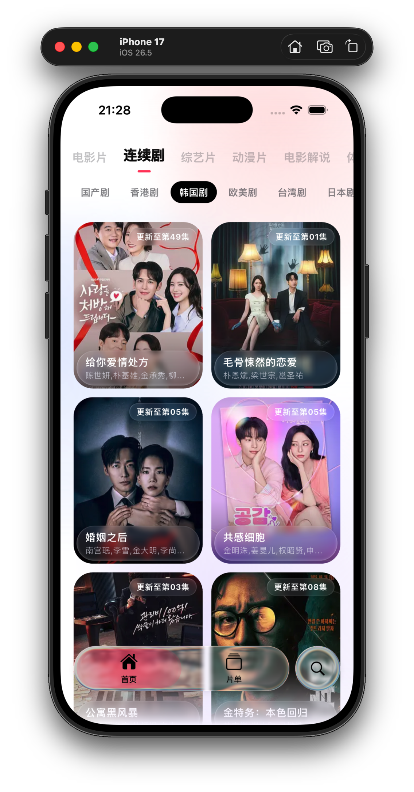
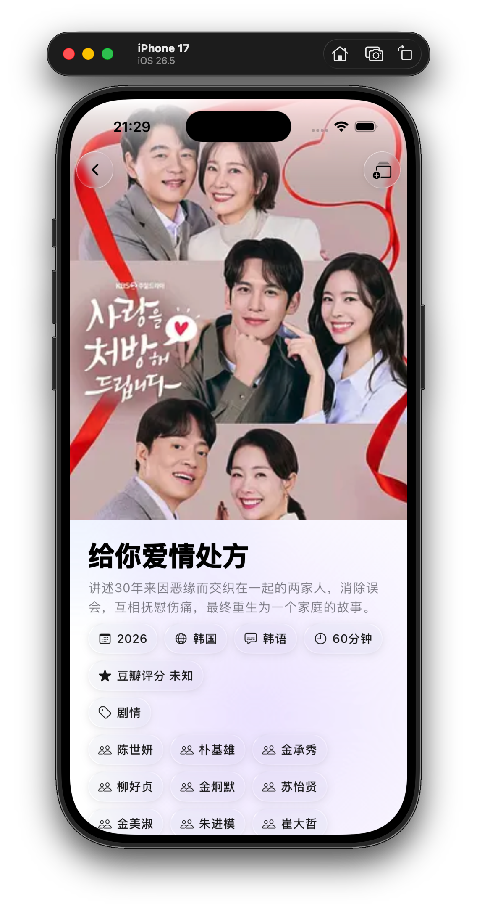
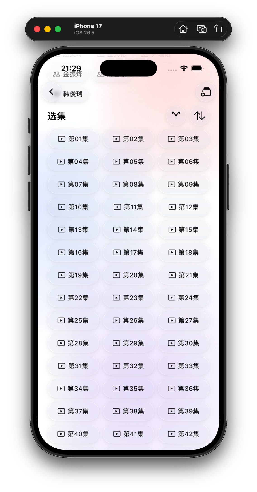
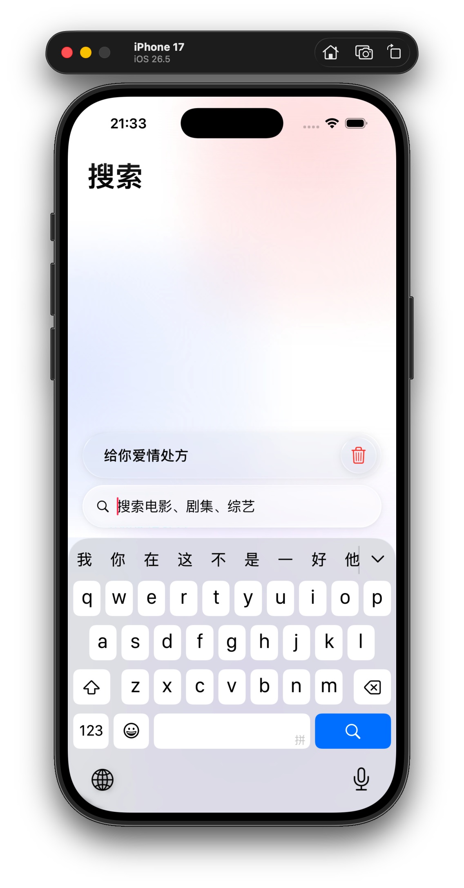
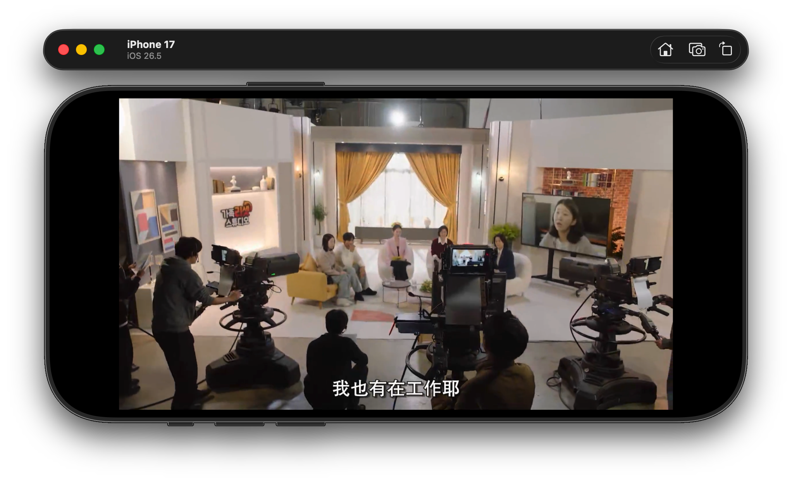
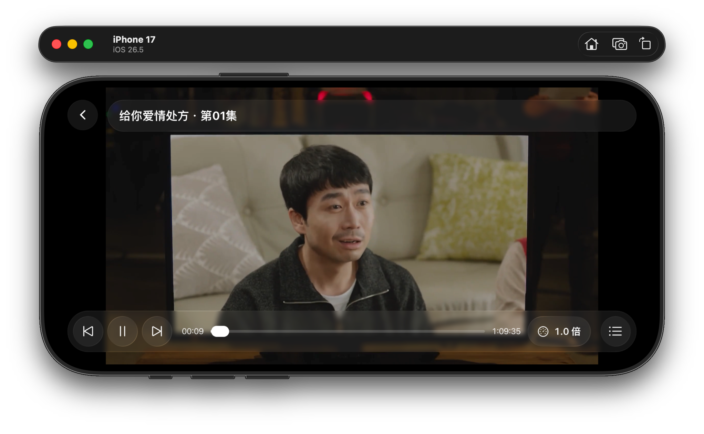
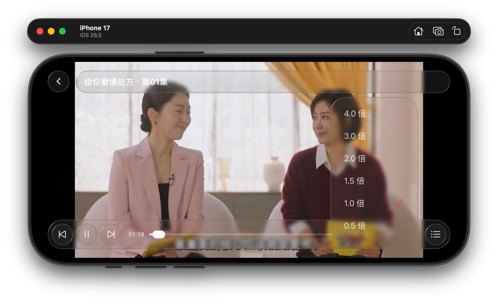
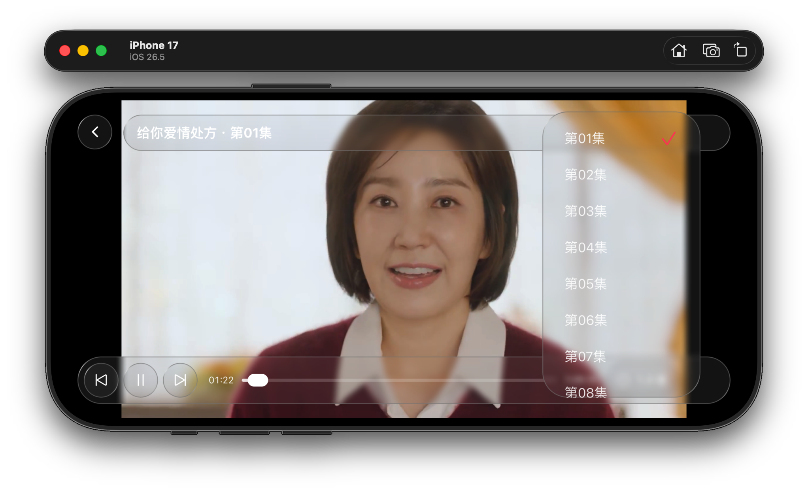

<div align="center">
  

# 哈狸影视

一款采用 iOS Liquid Glass 界面风格的苹果 CMS 影视第三方客户端。

[](#从源码运行与构建)
[](#安装)
[](#安装)
[](LICENSE)

[功能](#功能概览) · [预览](#界面预览) · [安装](#安装) · [构建](#从源码运行与构建) · [数据与隐私](#数据与隐私)

</div>

---

> [!IMPORTANT]
> 本项目为非官方客户端，仅供学习与技术交流。应用不托管、不制作任何影视内容；内容数据与版权归相应内容服务、原作者及权利人所有。

## 功能概览

- 按一级与二级分类浏览影视内容，并支持分页加载；
- 关键词搜索、搜索历史记录与一键清空；
- 影片详情、简介、演职员信息、多播放源与分集选集；
- 基于 media_kit 的在线播放、进度恢复、倍速与播放控制；
- 本地片单收藏、观看记录与继续播放；
- 适配浅色、深色系统外观的 Cupertino 液态玻璃界面。

## 界面预览

<div align="center">
  
  
  
  
  
  
  
  
</div>

## 安装

### Android

可按下方源码构建步骤生成 APK，将其传输至 Android 设备后按系统提示安装。当前仓库未配置自动发布工作流。

### iOS

需在 macOS 上使用 Xcode 配置开发团队和签名后，构建并安装到设备。未签名的应用产物不能直接安装。

## 使用说明与限制

- 分类、详情、播放源和分集信息来自所配置的苹果 CMS v10 内容服务，浏览与播放需要可访问相应服务的网络连接。
- 第三方服务接口、内容与播放地址变化可能影响加载或播放。遇到失败时，可检查网络后使用页面提供的重试或刷新操作。
- 片单、观看进度与搜索历史保存在本机，当前不提供账号登录或跨设备同步。
- 当前不提供影片下载或离线片库；图片缓存不代表影片可离线播放。
- 本文提供 Android 和 iOS 构建说明，其他平台目录不代表已有对应发行包或经过完整验证。

## 从源码运行与构建

### 环境要求

- Flutter SDK（包含 Dart 3.12.2 或兼容的 3.x 版本，以 `pubspec.yaml` 为准）
- 已配置对应目标平台的 Flutter 开发环境
- Android 构建需要 Android SDK 和 Java 17；iOS 构建需要 macOS、Xcode 与对应的签名配置
- 可访问内容服务的网络连接

### 配置内容服务

准备兼容苹果 CMS v10 接口的服务地址，并通过
`--dart-define="CMS_BASE_URL=https://example.com"` 在编译时直接注入地址。请将示例地址替换为实际服务地址；未配置或传入空地址时，应用会显示配置错误。

### 获取并运行

```bash
git clone https://github.com/halifox/cinema.git
cd cinema

flutter pub get

dart run build_runner build --delete-conflicting-outputs

flutter run --dart-define="CMS_BASE_URL=https://example.com"
```

仓库已包含当前生成的代码；当数据模型、API 或数据库定义发生变化时，需要重新执行代码生成。

### 构建安装包

在仓库根目录运行，并替换内容服务地址：

```bash
# Android arm64 Release APK
flutter build apk --release --target-platform android-arm64 --dart-define="CMS_BASE_URL=https://example.com"

# iOS 未签名应用：需在 macOS 上运行，产物不能直接安装
flutter build ios --release --no-codesign --dart-define="CMS_BASE_URL=https://example.com"

# iOS 签名 IPA：需先在 Xcode 中配置开发团队、证书与描述文件
flutter build ipa --release --dart-define="CMS_BASE_URL=https://example.com"
```

Android APK 输出到 `build/app/outputs/flutter-apk/`；iOS 未签名应用输出到 `build/ios/iphoneos/`，签名 IPA 输出到 `build/ios/ipa/`。当前 Android Release 配置使用调试签名，正式分发前需配置自己的发布签名。

### 技术栈

- **UI 框架** — Flutter / Cupertino / liquid_glass_widgets
- **状态管理** — Riverpod / Flutter Hooks
- **网络请求** — Dio / Retrofit
- **数据模型** — Freezed / json_serializable
- **本地存储** — Drift / Shared Preferences
- **图片加载** — cached_network_image
- **分页加载** — riverpod_paging_utils
- **媒体播放** — media_kit / media_kit_video

## 数据与隐私

### 本地数据

片单收藏、影片信息、观看记录、播放进度与搜索历史通过 Drift 存储在本地 SQLite 数据库中；网络图片由图片缓存组件管理。

可在搜索历史页面清空搜索记录。Android 可通过系统应用设置清除应用存储，删除本地数据库、设置和缓存；此操作不可撤销。

### 网络请求与诊断

浏览和搜索时，应用会向所配置的内容服务发送请求，包含相应的分类、分页、搜索关键词或影片标识。加载海报和播放影片时，还会访问内容服务返回的图片与媒体地址。

调试构建启用 Dio 网络日志，可能包含请求地址、参数和请求头。提交 Issue 或分享日志前，请删除个人信息与其他敏感内容。

## 许可证与第三方内容

本项目源代码遵循 [GPL-3.0 License](LICENSE)。第三方依赖遵循各自的许可证，依赖列表见 [pubspec.yaml](pubspec.yaml)。

影视内容的版权归原作者及相关权利人所有，不适用本项目的代码许可证。本项目的许可证声明不构成内容、商标或品牌授权。

## 参与贡献

欢迎提交问题、改进建议和 Pull Request。提交代码前，请阅读 [AGENTS.md](AGENTS.md) 中的协作约束。

反馈问题时，请说明应用版本、平台、复现步骤和错误现象；附带截图或日志前请先脱敏。
